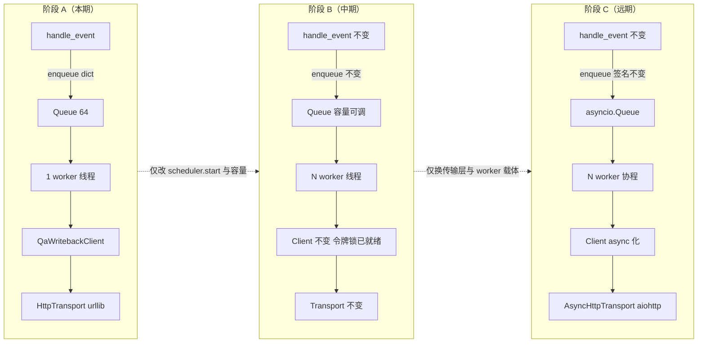
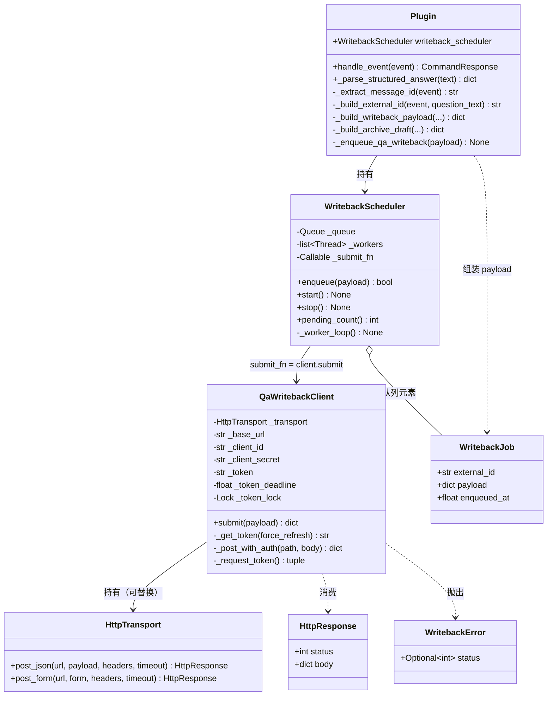
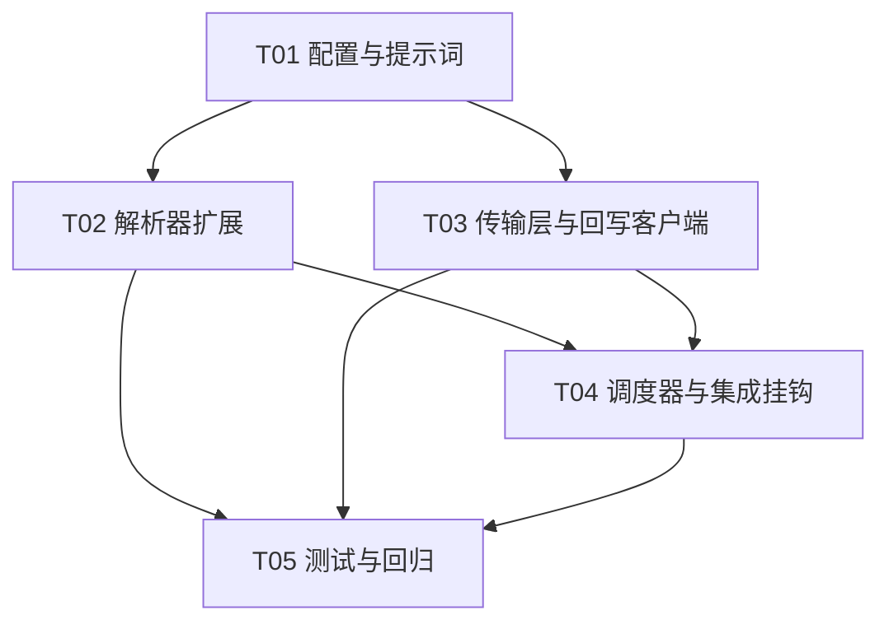

# 答疑内容归档入题库 · 实施设计（增量架构 + 任务分解）

> 关联 Issue：[#3 实施](https://github.com/25456434337346646/astrbot_plugin_xelatex-pdf/issues/3)（本文档）、[#2 研究](https://github.com/25456434337346646/astrbot_plugin_xelatex-pdf/issues/2)
> 上游文档：`docs/qa-archive-research.md`（研究定稿：提示词、字段映射、容错矩阵）
> 分支：`research/qa-archive`
> 状态：实施设计（不含代码改动）
> 日期：2026-08-28

---

## 0. 设计总览

```
handle_event（async，事件循环线程）
  │  编译成功分支（main.py:359）
  │  ① 组装 WritebackPayload（纯数据，全部字段在此刻冻结）
  │  ② scheduler.enqueue(payload)  ← 同步、非阻塞、永不抛错
  ▼
WritebackScheduler（调度/队列层）
  │  queue.Queue(maxsize=64)，满时丢弃最新 + 告警日志
  ▼
worker 线程（daemon × 1，与文件服务线程同款模式）
  │  阻塞 get() → submit(payload) → 结果只记日志
  ▼
QaWritebackClient（业务编排层：令牌缓存 + 三步 POST + 重试）
  ▼
HttpTransport（传输层抽象，当前实现 = urllib）
```

**硬约束**：`requirements.txt` 保持零第三方依赖（只用标准库 `queue`/`threading`/`urllib`/`hashlib`/`logging`）。

**分层原则**：调用方（`handle_event`）只认 `scheduler.enqueue(dict)`；调度层只认「一个可提交 payload 的 worker 线程 + 一个有界队列」；业务层只认 `transport.post_json(...)` 的签名。三层各自可替换，边界处只有纯数据（dict / dataclass）通过。

---

## 1. 模块划分（新增代码在 main.py 的位置）

### 1.1 模块级新增（`Plugin` 类之外）

| 模块 | 插入位置（行号锚点） | 内容 |
|---|---|---|
| 常量 | `main.py:32` 常量区末尾（`STALE_WORKDIR_MAX_AGE_SECONDS` 之后） | `WRITEBACK_QUEUE_MAXSIZE = 64`、`WRITEBACK_TIMEOUT_SECONDS = 15`、`WRITEBACK_MAX_ATTEMPTS = 3`、`WRITEBACK_RETRY_BASE_DELAY = 1.0`、`TOKEN_EXPIRY_MARGIN_SECONDS = 60`、`ARCHIVE_TYPE_WHITELIST`（六值集合）、日志前缀 `WRITEBACK_LOG_PREFIX = "[qbk]"` |
| `import logging` | `main.py:1-21` 导入区（`import json` 附近，字母序） | 全文件现在**没有任何 logging**，这是首次引入 |
| `logger = logging.getLogger("astrbot_plugin_xelatex_pdf")` | 常量区之后 | 模块级 logger |
| 数据类 `HttpResponse`、`WritebackJob` | `main.py:134` `SessionMemory` 之后、`main.py:146` `@register` 之前（沿用现有 `@dataclass(slots=True)` 风格） | 见 §5 |
| `class WritebackError(RuntimeError)` | 同上 | 携带 `status: Optional[int]`，供重试决策 |
| `class HttpTransport` | 同上 | 传输层当前实现（urllib），见 §3.1 |
| `class QaWritebackClient` | 同上 | 令牌缓存 + 三步 POST，见 §2 |
| `class WritebackScheduler` | 同上 | 队列 + worker 生命周期，见 §3 |

### 1.2 `Plugin` 类内改动

| # | 位置 | 改动 |
|---|---|---|
| 1 | `__init__`（`main.py:163-212`），在 `_start_file_server()`（212 行）之前 | 读 4 个新配置项；构造 `self.writeback_scheduler`（未配置/未开启时为 no-op 空转实例） |
| 2 | system prompt（`main.py:726-742`） | 在「内容要求」（739 行）之后追加研究文档 §3.2 定稿归档段 |
| 3 | `_parse_structured_answer`（`main.py:1009-1032`） | 扩展：识别围栏块、剥离、逐字段容错解析；返回字典增加 `"archive"` 键 |
| 4 | `handle_event` 成功分支（`main.py:359-363`） | 追加 3 行：组 payload → `self._enqueue_qa_writeback(payload)`（钩子内部做开关判断与异常兜底） |
| 5 | 新增方法簇（放在 `_extract_qq_number` 附近，`main.py:2100-2132` 区域） | `_extract_message_id(event)`、`_build_external_id(event, question_text)`、`_build_writeback_payload(...)`、`_build_archive_draft(structured, question_text, image_urls)`、`_enqueue_qa_writeback(payload)` |
| 6 | `_build_file_handler`（`main.py:2185-2191`）+ `_public_file_url`（`main.py:2159-2168`） | `category_dirs` 与路由前缀循环各加一项 `"asset": self.asset_dir`，使题目图片可获得公网 URL（见 §7 待明确 Q3） |
| 7 | `terminate`（`main.py:221-232`） | 追加 `self.writeback_scheduler.stop()`（在文件服务 shutdown 之前） |
| 8 | `_conf_schema.json` | 增 4 项（§6） |
| 9 | `tests/test_plugin.py` | `bare_plugin()` 工厂补属性 + 新增测试类（任务 T05） |

---

## 2. 回写客户端设计（`QaWritebackClient`）

### 2.1 类签名

```python
class QaWritebackClient:
    """题库开放 API 回写客户端。线程安全：仅被单个 worker 线程调用，
    令牌状态由 threading.Lock 保护（为多 worker 升级预留）。"""

    def __init__(self, transport: HttpTransport, base_url: str,
                 client_id: str, client_secret: str,
                 timeout: int = WRITEBACK_TIMEOUT_SECONDS) -> None: ...

    def submit(self, payload: dict[str, Any]) -> dict[str, Any]:
        """执行 ①令牌 ②提问 ③答复 ④归档 全链路；返回摘要（供日志）。
        永久失败抛 WritebackError；调用方（worker）负责捕获。"""

    # 内部方法
    def _get_token(self, force_refresh: bool = False) -> str: ...
    def _post_with_auth(self, path: str, body: dict[str, Any]) -> dict[str, Any]:
        """带 Bearer 头的 POST；401 → 强制刷新令牌重试一次（仅一次）。"""
    def _request_token(self) -> tuple[str, float]: ...
```

### 2.2 令牌缓存与 401 续期

| 要点 | 设计 |
|---|---|
| 获取 | `POST {base}/api/oauth/token`，头 `Authorization: Basic base64(client_id:client_secret)`，正文 `application/x-www-form-urlencoded`：`grant_type=client_credentials`（与 `outputs/qa-writeback-integration.md` §2 实测契约一致） |
| 缓存 | `self._token: str`、`self._token_deadline: float`（`time.monotonic() + expires_in - TOKEN_EXPIRY_MARGIN_SECONDS`）。实测 `expires_in = 2592000`（30 天），提前 60s 视为过期 |
| 续期 | 两条路径：① `_get_token()` 发现 `monotonic() >= deadline` 主动刷新；② 业务请求收到 **401** → `force_refresh=True` 刷新并重发该请求**一次**（防止服务端提前吊销/时钟偏差） |
| 并发防护 | `self._token_lock = threading.Lock()`；刷新在锁内做，双重检查（进锁后再查一次 deadline，避免多 worker 时重复刷新） |
| 失败 | 令牌请求本身失败按 §2.4 重试矩阵处理；最终失败抛 `WritebackError` |

### 2.3 三步 POST 顺序与失败处理

```
① POST /api/open/v1/qa/requests
   body: {external_id, channel:"qq_bot", channel_subject:qq, qq,
          question_text, question_images, meta}
   成功判定: status ∈ {200, 201}（200+deduplicated:true 是幂等命中，等同成功）
   取用字段: data["request"]["id"]（响应契约见 qa-writeback-integration.md §3）
        │ 失败 → 整任务终止（无 request 则后续无锚点）
        ▼
② POST /api/open/v1/qa/requests/{id}/answer
   body: {answer_text, analysis_text, external_ref: pdf_url}
   answer_text 必填：回落链 [ANSWER] → [SUMMARY] → "（模型未给出答案）"
        │ 失败 → 记日志；仍尝试 ③（归档不依赖 answer 步骤）
        ▼
③ POST /api/open/v1/archive/entries
   body: {qa_request_id: <①的 id>, external_id, draft:{stem,answer,analysis,
          type,difficulty,images,tags}}
   成功判定: status ∈ {200, 201}（deduplicated:true 视为成功）
```

**部分成功语义**：三步不是事务。①成功后 ②/③ 任一失败，只记日志不重跑整个任务——重跑会因 ① 的幂等而安全，但 ② 是追加式（`qa-writeback-integration.md` §4：不做 UPDATE），重跑会产生重复答复行，故**任务级不重试已成功的步骤之后段**；重试只发生在单个 HTTP 请求层面（§2.4）。

### 2.4 单请求重试矩阵

| 情形 | 判定 | 动作 |
|---|---|---|
| 网络错误 / 超时（`URLError`、`socket.timeout`、`ConnectionError`） | 可重试 | 退避重发 |
| HTTP 429 / 5xx | 可重试 | 退避重发 |
| HTTP 401（业务请求） | 特殊 | 强制刷新令牌重发一次；再 401 按永久失败 |
| HTTP 400 / 403 / 404 / 其他 4xx | 永久失败 | 抛 `WritebackError`，不重试（403=scope 不足、404=越权，重试无意义；排查看管理台调用日志） |
| 响应体非 JSON / 缺 `request.id` | 永久失败 | 抛 `WritebackError` |

退避策略：`delay = WRITEBACK_RETRY_BASE_DELAY * 2**(attempt-1) + random.uniform(0, 0.5)`，即约 1s、2s；共 `WRITEBACK_MAX_ATTEMPTS = 3` 次。最坏单任务耗时上界 ≈ 3 请求 × 3 次 × 15s 超时 + 退避 ≈ 2.5 分钟，单 worker 下可接受（队列容量 64 足以缓冲）。

---

## 3. 并发架构（调度/队列层 与 传输层解耦）

### 3.1 传输层抽象（当前实现 = urllib）

```python
@dataclass(slots=True)
class HttpResponse:
    status: int
    body: dict[str, Any]


class HttpTransport:
    """传输层当前实现：标准库 urllib，同步阻塞。
    升级时整体替换本类即可（见 §4 路线 C），签名不变。"""

    def post_json(self, url: str, payload: dict[str, Any],
                  headers: dict[str, str], timeout: int) -> HttpResponse:
        """POST JSON；HTTP 错误（含 4xx/5xx）转为带 status 的 HttpResponse 返回，
        不抛 HTTPError——重试决策交给上层。网络层异常原样上抛。"""

    def post_form(self, url: str, form: dict[str, str],
                  headers: dict[str, str], timeout: int) -> HttpResponse:
        """application/x-www-form-urlencoded（令牌端点专用）。"""
```

实现要点：复用 `_post_chat_completion`（`main.py:779-793`）的写法，但把 `urllib.error.HTTPError` **捕获并读正文**转为 `HttpResponse(status=exc.code, body=<尽力解析的 JSON>)`，而不是像现有代码那样直接抛 `RuntimeError`——这是重试矩阵能区分 401/429/5xx 的前提。

### 3.2 队列与背压

| 参数 | 值 | 理由 |
|---|---|---|
| 队列类型 | `queue.Queue(maxsize=WRITEBACK_QUEUE_MAXSIZE)` | 标准库、线程安全、`block=False` 天然支持丢弃策略 |
| 容量 | **64** | 单群答疑频率远低于编译耗时（每题 ≥ 数十秒），64 条 ≈ 数小时积压上限，内存占用可忽略 |
| 满时策略 | **丢弃最新（drop-newest）**：`put_nowait` 抛 `queue.Full` → 记 WARNING（含 external_id）并丢弃 | 归档是旁路资产，丢一条可人工补录；**绝不阻塞事件循环**，也绝不挤占答疑。不阻塞生产者是本层第一铁律 |
| 关闭排空 | `stop()` 发送哨兵 `None`，worker 处理完队列内剩余任务后退出；`join` 限时 5s，超时不等待（daemon 线程兜底） | 与 `terminate` 现有文件服务 shutdown 纪律一致（`main.py:221-232`） |

### 3.3 worker 模型与线程/协程选择

**选择：单个 daemon 线程 + 阻塞 `queue.get()`，不用 asyncio 任务。**

| 候选 | 结论 | 理由 |
|---|---|---|
| **daemon 线程 + `queue.Queue`** | ✅ 采用 | ① 传输层是同步 urllib，线程内直接跑，无需 `to_thread` 包装；② 与插件现有文件服务线程（`main.py:2182`）同款模式，代码风格一致；③ 不占用事件循环——答疑主链路的 `asyncio.to_thread` 池不被回写挤占；④ 生产端 `enqueue` 是纯同步调用，`handle_event`（async）里直接调，无需 `create_task`，也就没有孤儿 task 被 GC 的经典坑 |
| `asyncio.Queue` + `create_task` worker | ❌ | 传输层同步，worker 协程里还得 `await asyncio.to_thread(...)`，多一层包装无收益；且研究文档 §2 写的 `asyncio.create_task` fire-and-forget 存在 task 引用丢失风险 |
| 每次回写临时 `threading.Thread` | ❌ | 无背压、无排队、并发不可控，正是升级路线要规避的形态 |

```python
class WritebackScheduler:
    """调度/队列层。只依赖『一个可调用的 submit_fn(payload) -> dict』，
    不感知 HTTP/令牌/题库契约——那是 QaWritebackClient 的事。"""

    def __init__(self, submit_fn: Optional[Callable[[dict[str, Any]], Any]],
                 maxsize: int = WRITEBACK_QUEUE_MAXSIZE) -> None:
        # submit_fn 为 None（未配置/开关关闭）时，enqueue 静默 no-op

    def enqueue(self, payload: dict[str, Any]) -> bool:
        """同步、非阻塞、永不抛错。入队成功返回 True；
        队列满丢弃返回 False（已记 WARNING）；未启用返回 False。"""

    def start(self) -> None:   # 幂等；创建 daemon 线程
    def stop(self) -> None:    # 哨兵 + 排空 + 限时 join
    def pending_count(self) -> int:  # 观测用（队列 qsize）
```

worker 主循环（伪代码）：

```python
def _worker_loop(self) -> None:
    while True:
        job = self._queue.get()
        if job is None:            # 哨兵：排空后退出
            break
        try:
            self._submit_fn(job.payload)
            logger.info("%s 回写成功 external_id=%s", WRITEBACK_LOG_PREFIX, ...)
        except Exception as exc:   # 兜底：任何异常只记日志，绝不上抛
            logger.warning("%s 回写失败 external_id=%s err=%s", ...)
```

### 3.4 失败隔离原则的落实（逐条对账）

| 研究文档三原则 | 落实机制 |
|---|---|
| 回写失败只记日志，不影响答疑 | ① `enqueue` 同步非阻塞且自身 `try/except` 全兜底；② worker 线程内 `except Exception` 只记日志；③ 钩子 `_enqueue_qa_writeback` 在 `handle_event` 里再包一层 `try/except`，payload 组装出错也不影响 `return response` |
| 令牌 401 自动续期 | §2.2 双路径（到期主动刷新 + 401 被动刷新一次） |
| `external_id` 幂等 | §5.3 生成规则；QQ 消息 id 优先，重发天然去重（服务端 200+`deduplicated:true`） |

---

## 4. 并发升级路线（当前 → 中期 → 远期）

> 分层契约：调用方只认 `scheduler.enqueue(dict)`；调度层只认 `submit_fn(payload)`；业务层只认 `transport.post_json(...)`。每一步升级只动一层。

### 阶段 A · 当前（本设计交付形态）

```
事件循环 ──enqueue(dict)──▶ Queue(64) ──▶ 1 × daemon 线程 ──▶ QaWritebackClient ──▶ HttpTransport(urllib)
```

- 单 worker、有界队列、drop-newest
- 吞吐瓶颈在编译（每题数十秒），单 worker 绰绰有余

### 阶段 B · 中期：多 worker 并发消费（队列容量与背压先行）

| 改什么 | 不改什么 |
|---|---|
| `WritebackScheduler.start()` 起 N 个 worker 线程（N 配置化，如 2-4），共享同一 `queue.Queue`（线程安全，零改动） | `enqueue` 签名与调用方（`handle_event`）零改动 |
| 按吞吐观察调 `WRITEBACK_QUEUE_MAXSIZE`；如需更激进背压，可在 `enqueue` 加「按 external_id 去重」的入队前过滤 | `QaWritebackClient` 零改动——令牌锁（§2.2）与三步顺序天然线程安全；服务端幂等兜底并发重发 |
| （可选）丢弃策略从 drop-newest 换成「丢弃最旧」：`get_nowait()` 腾位再 `put` | 传输层零改动 |

**触发条件**：管理台调用日志出现持续积压（`pending_count()` 长期 > 容量一半）或 429 频发。

### 阶段 C · 远期：换异步传输层（aiohttp）——只改传输层，不动调度层与调用方

| 改什么 | 不改什么 |
|---|---|
| 新增 `AsyncHttpTransport`，实现与 `HttpTransport` 相同的方法签名（async 版）；`QaWritebackClient` 增加 async 版 `submit`（或整体换 aiohttp 客户端） | `WritebackJob`/payload 数据结构零改动 |
| worker 从线程换为事件循环上的 `asyncio.Queue` + N 个 worker 协程；`enqueue` 内部改用 `loop.call_soon_threadsafe` 或 `put_nowait`（接口签名不变） | `handle_event` 钩子零改动（仍只调 `scheduler.enqueue(dict)`） |
| 依赖约束放宽：仅在此阶段才引入 aiohttp（需同步更新 `requirements.txt` 与 `THIRD_PARTY_NOTICES.md`） | 队列容量/背压/丢弃策略的语义不变，只换容器类型 |

**关键保证**：阶段 A→B→C 中，`handle_event` 里的那一行 `self._enqueue_qa_writeback(payload)` 与 `_parse_structured_answer` 的产出结构**始终不需要改**——这就是「传输层与调度层解耦」的验收标准。



---

## 5. 数据结构

### 5.1 类图



### 5.2 archive dict schema（`_parse_structured_answer` 返回的 `"archive"` 键）

```python
{
    "present": bool,        # 是否检测到 [ARCHIVE] 围栏块；False 时跳过整个回写
    "stem": str,            # [STEM] 原文（去标记、strip）；缺失为 ""
    "answer": str,          # [ANSWER]；缺失为 ""
    "type": str,            # ∈ {single,multiple,blank,proof,calc,answer}；非法/缺失 → "answer"
    "difficulty": int,      # 1-5；非法/缺失 → 3
    "tags": list[str],      # 英文逗号分隔 → 数组，去空白去重，截断至 20（API 上限）
}
```

**解析容错矩阵**（沿用研究文档 §3.4，逐行容错）：

| 情况 | 处理 |
|---|---|
| 无 `[ARCHIVE]` 围栏块 | `present=False`，跳过回写（非题场景，正常路径） |
| 有 `[ARCHIVE]` 无 `[/ARCHIVE]` | 取到文本末尾；仍按逐行解析（宽容） |
| 块内某标记行缺失/空值 | 该字段回落默认（`type→"answer"`、`difficulty→3`、其余 `""`） |
| `[TYPE]` 非法值 | 丢弃该值 → `"answer"`（服务端 `parseDraft` 会再校验一次，双保险） |
| `[DIFFICULTY]` 非 1-5 整数 | 丢弃 → `3` |
| 围栏块外的 `[ANSWER]` 等字样 | **不解析**（围栏保证边界，正文零误吞） |
| 剥离时机 | 在 `build_tex_source`（`main.py:337`）之前，`body` 已无归档块，PDF 零污染 |

### 5.3 external_id 生成规则

```python
def _build_external_id(self, event: Any, question_text: str) -> str:
    message_id = self._extract_message_id(event)
    if message_id:
        return f"qq:{message_id}"
    digest = hashlib.sha256((question_text or "").encode("utf-8")).hexdigest()[:16]
    return f"ts:{time.strftime('%Y%m%d%H%M%S')}:{digest}"
```

| 分支 | 形态 | 说明 |
|---|---|---|
| 取到消息 id | `qq:<message_id>` | 幂等主路径：重发同消息 → 同 id → 服务端 `deduplicated:true` |
| 取不到 | `ts:<YYYYmmddHHMMSS>:<sha256(题干)[:16]>` | 回落路径：秒级时间戳 + 题干哈希，同一题同秒重发仍去重 |

`_extract_message_id` 的 duck-typing 顺序（仿 `_extract_qq_number`，`main.py:2100-2113`）：

```python
for source in (event, getattr(event, "message_obj", None)):
    for attr in ("message_id", "msg_id", "id"):
        value = getattr(source, attr, None)
        if value:
            return str(value)
return ""
```

> ⚠️ AstrBot `AstrMessageEvent` 上消息 id 的确切属性名**未在现有代码中得到证实**（全文件仅 1837 行在 Reply 组件上探测过 `message_id`），列入实施实测项（§7 Q1）。

### 5.4 回写 payload（`WritebackJob.payload`）——入队时刻冻结全部字段

```python
{
    "external_id": str,                 # §5.3
    "question_text": str,               # _extract_user_question 产出
    "question_images": list[str],       # 题目图片公网 URL（§7 Q3 方案）
    "qq": str,                          # _extract_qq_number 产出
    "meta": {
        "model": str,                   # used_model
        "base_name": str,               # 统一命名基名
        "pdf_url": str,                 # response.file_payload["url"]
        "session_id": str,
    },
    "answer_text": str,                 # [ANSWER] → [SUMMARY] → 占位串
    "analysis_text": str,               # structured["body"]
    "draft": {                          # _build_archive_draft 产出（§5.2 + 回落）
        "stem": str,                    # archive.stem 或回落 question_text
        "answer": str,                  # 同 answer_text
        "analysis": str,                # 同 analysis_text
        "type": str, "difficulty": int,
        "images": list[str],            # 同 question_images
        "tags": list[str],
    },
}
```

---

## 6. 配置项设计（`_conf_schema.json` 增 4 项）

| 键 | 类型 | 默认 | 环境变量回落 | 说明 |
|---|---|---|---|---|
| `qbk_base_url` | string | `http://172.17.0.1:3000` | `XELATEX_QBK_BASE_URL` | 题库基址。**勿用 172.19.0.1**（compose 网络重建会漂移，`qa-writeback-integration.md` §1） |
| `qbk_client_id` | string | `""` | `XELATEX_QBK_CLIENT_ID` | OAuth client_id |
| `qbk_client_secret` | string | `""` | `XELATEX_QBK_CLIENT_SECRET` | OAuth secret；`obvious_hint: true`（与 `text_api_key` 同款）；生产建议凭据文件挂载 + 环境变量注入，不写明文配置 |
| `archive_enabled` | bool | `false` | `XELATEX_ARCHIVE_ENABLED` | 灰度总开关，默认关；先单测 + 探针通过再开（研究文档 §6 纪律） |

读取方式沿用 `_get_config_value`（`main.py:1439-1444`）。**启用判定**（`__init__` 内）：

```python
self.writeback_scheduler = WritebackScheduler(submit_fn=None)   # 默认空转
if archive_enabled and qbk_base_url and qbk_client_id and qbk_client_secret:
    client = QaWritebackClient(HttpTransport(), qbk_base_url, qbk_client_id, qbk_client_secret)
    self.writeback_scheduler = WritebackScheduler(submit_fn=client.submit)
    self.writeback_scheduler.start()
else:
    logger.info("[qbk] 归档回写未启用（开关关闭或凭据未配置）")
```

四项任一缺失 → 调度器空转（`enqueue` no-op），**不产生启动错误**——与「回写是旁路」原则一致。

---

## 7. 待明确事项（实施时确认）

| # | 问题 | 现状判断 | 处置 |
|---|---|---|---|
| Q1 | AstrBot `AstrMessageEvent` 上消息 id 的确切属性名 | 现有代码无直接用例；`_fetch_reply_message_via_adapter`（`main.py:1837`）对 Reply 组件按 `["start_id","id","message_id","msg_id",...]` 探测，提示 OneBot 系适配器大概率有 `message_id` | **实施实测项**：真实环境打印 `dir(event)` / `event.message_obj` 确认；`_extract_message_id` 的多属性探测 + `ts:` 回落已兜底，实测失败不阻塞交付 |
| Q2 | `archive/entries` 用 `qa_request_id` 还是 `external_id` 关联 | 研究文档 §1.2：二选一均可 | 设计取 `qa_request_id`（① 的返回值，强关联）+ `external_id` 同传兜底；若服务端校验拒绝多余字段，删其一即可，不影响结构 |
| Q3 | 题目图片公网 URL 的获得方式 | `localize_attachments`（`main.py:325`）后图片是本地文件（`asset_dir`），而文件服务只路由 `pdf/source/log` 三类（`main.py:2187-2191`），**assets 不在路由内** | 设计取「文件服务加 `asset` 路由 + 图片按 `base_name` 前缀复制/命名进 asset_dir 后取 `_public_file_url`」；若评审认为改动面大，降级方案：`question_images` 传空数组（API 允许），图片缺口留后续 |
| Q4 | `channel_subject` 取值 | 研究文档 §1.2 称 qq_bot 渠道 `channel_subject`/`qq` 必填 | `channel_subject` 与 `qq` 同值（均为 QQ 号）；若服务端要求的是群号/科目名，实施时按 400 报错信息调整 |
| Q5 | 多轮追问重复回写 | 仅编译成功分支触发；同一消息 id 幂等去重 | 无需处理（研究文档 §7 已论证） |

---

## 8. 任务列表（按实现顺序，含依赖）

> 依赖关系：T01 是地基；T02/T03 仅依赖 T01、彼此可并行；T04 集成依赖 T02+T03；T05 收尾。

| 任务 | 内容 | 文件 / 函数 | 依赖 | 验收点 |
|---|---|---|---|---|
| **T01 配置与提示词** | ① `_conf_schema.json` 增 4 项（§6）；② `__init__` 读配置 + 启用判定（**先挂空转调度器占位**，T04 接真身）；③ system prompt 追加研究文档 §3.2 定稿归档段 | `_conf_schema.json`；`main.py` `__init__`（163-212）、`generate_answer` prompt（726-742） | — | schema JSON 合法（现有 `test_configuration_schema_is_valid_json` 通过）；`archive_enabled=false` 时行为与改造前逐字节一致（无归档块要求则模型输出不变） |
| **T02 解析器扩展** | ① `_parse_structured_answer` 识别 `[ARCHIVE]…[/ARCHIVE]` 围栏、逐行容错、body 剥离、返回增 `"archive"` 键；② `_extract_message_id`、`_build_external_id`；③ `_build_archive_draft`（白名单校验 + 回落） | `main.py` `_parse_structured_answer`（1009-1032）、`_extract_qq_number` 附近（2100+） | T01 | 研究文档 §3.4 容错矩阵全过：正常块 / 缺块 / 块内坏行 / 非法 TYPE / 非法 DIFFICULTY / 剥离后 body 无 `[ARCHIVE]` 残留；`[TITLE]`/`[SUMMARY]` 既有行为零回归 |
| **T03 传输层与回写客户端** | ① 常量区新增（§1.1）+ `import logging` + 模块 logger；② `HttpResponse`、`WritebackError`、`HttpTransport`（§3.1）；③ `QaWritebackClient`（§2：令牌缓存/401 续期/三步顺序/重试矩阵） | `main.py` 常量区（24-32）、导入区（1-21）、`SessionMemory` 后至 `@register` 前（134-146） | T01 | mock transport 单测：令牌缓存命中不重取；401 → 刷新重发一次；429/5xx 退避重试 ≤3 次；400 不重试直接抛；三步顺序与请求体字段正确 |
| **T04 调度器与集成挂钩** | ① `WritebackJob`、`WritebackScheduler`（§3.2/3.3）；② `__init__` 接真身（替换 T01 占位）、`terminate` 加 `stop()`；③ `handle_event` 成功分支（359-363）挂钩：`_build_writeback_payload` + `_enqueue_qa_writeback`；④ 文件服务 `asset` 路由 + `_public_file_url` 扩展（§7 Q3） | `main.py` `WritebackScheduler`（模块级）、`__init__`、`terminate`（221-232）、`handle_event`（359-363）、`_build_file_handler`（2185）、`_public_file_url`（2146-2169） | T02, T03 | 编译成功 → 队列收到 1 条 payload（字段全）；编译失败/无归档块 → 不入队；队列满 → 丢弃且仅 WARNING；worker 内抛任何异常 → 仅日志、`handle_event` 正常返回；`terminate` 后 worker 退出 |
| **T05 测试与回归** | ① `bare_plugin()` 工厂补属性（`writeback_scheduler` 等）；② 新增测试类：`ArchiveParseTests`（容错矩阵）、`ExternalIdTests`、`WritebackClientTests`（mock transport）、`SchedulerTests`（入队/丢弃/关闭）、集成路径（编译成功触发 enqueue 的桩测试）；③ 全量回归 | `tests/test_plugin.py` | T02, T03, T04 | `python -m unittest discover tests` 全绿；既有 7 个测试类零回归；§3.4 失败隔离三原则各有对应测试钉住 |



---

## 9. 共享知识（跨函数约定，工程师必读）

1. **日志前缀**：所有回写相关日志一律 `logger.<level>("[qbk] ...")`（常量 `WRITEBACK_LOG_PREFIX`）。关键日志点：入队成功（DEBUG）、队列满丢弃（WARNING，含 external_id）、回写成功（INFO，含 external_id 与 `deduplicated`）、回写失败（WARNING，含 external_id、步骤、HTTP status）、令牌刷新（INFO）。**禁止**把 `client_secret` / 完整令牌写进日志。
2. **标记解析容错铁律**：围栏外的任何 `[XXX]` 字样一律不解析；块内单行坏只丢该字段、回落默认；**任何解析异常都不得向调用方抛出**——`_parse_structured_answer` 的契约是「永远返回完整四键 dict」。
3. **失败隔离铁律**：`_enqueue_qa_writeback` 与 `enqueue` 内部全兜底，`handle_event` 中回写相关代码的任何异常都不允许改变 `return response` 的值。
4. **命名与风格**：沿用现有约定——`_` 前缀私有方法、`@dataclass(slots=True)`、类型注解全写、中文注释、常量全大写置于文件头。
5. **零依赖红线**：只允许标准库（`queue`/`threading`/`logging`/`hashlib`/`urllib`/`time`/`random` 均已在或属标准库）；`requirements.txt` 与 `THIRD_PARTY_NOTICES.md` 不得改动。
6. **HTTP 错误语义**：传输层把 4xx/5xx 转成 `HttpResponse`（不抛），业务层按 §2.4 矩阵决策；`200 + deduplicated:true` 永远视为成功。
7. **配置读取**：新配置一律走 `_get_config_value(key, env_key, default)`，环境变量前缀 `XELATEX_QBK_*` / `XELATEX_ARCHIVE_*`。
8. **测试写法**：沿用 `bare_plugin()` 工厂 + `unittest.mock.patch`；网络一律 mock `HttpTransport`，**测试中不得出现真实网络调用**。

---

## 10. 附：关键行号索引（实施对照）

| 锚点 | 行号 |
|---|---|
| 导入区 / 常量区 | `main.py:1-21` / `24-32` |
| 数据类区（`CompileResult`…`SessionMemory`） | `main.py:89-144` |
| `@register` / `Plugin` 类起点 | `main.py:146-147` |
| `__init__` | `main.py:163-212` |
| `terminate` | `main.py:221-232` |
| `handle_event` / 编译成功分支 | `main.py:290-364` / `359-363` |
| system prompt | `main.py:726-742` |
| `_post_chat_completion`（urllib 参照） | `main.py:779-793` |
| `_parse_structured_answer` | `main.py:1009-1032` |
| `_get_config_value` | `main.py:1439-1444` |
| `localize_attachments` | `main.py:1608-1611` |
| `get_session_id` | `main.py:1688-1698` |
| `_extract_qq_number`（duck-typing 参照） | `main.py:2100-2113` |
| `_public_file_url` | `main.py:2146-2169` |
| `_build_file_handler`（分类路由） | `main.py:2185-2234` |
| 文件服务线程（线程模式参照） | `main.py:2182-2183` |
